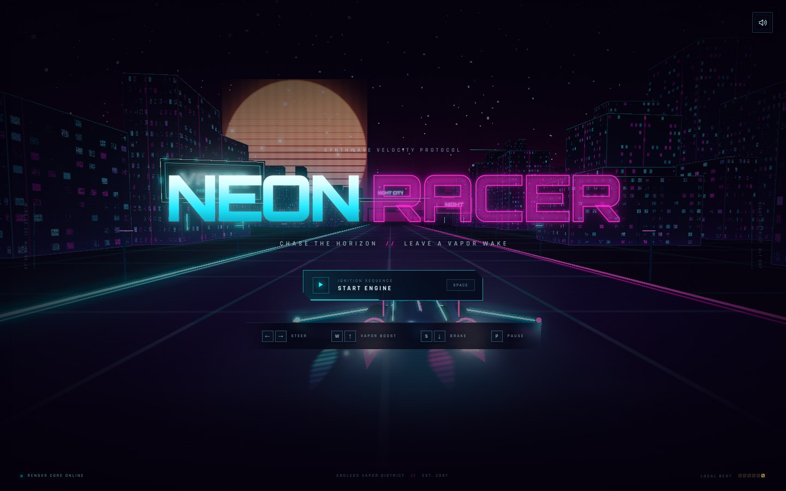
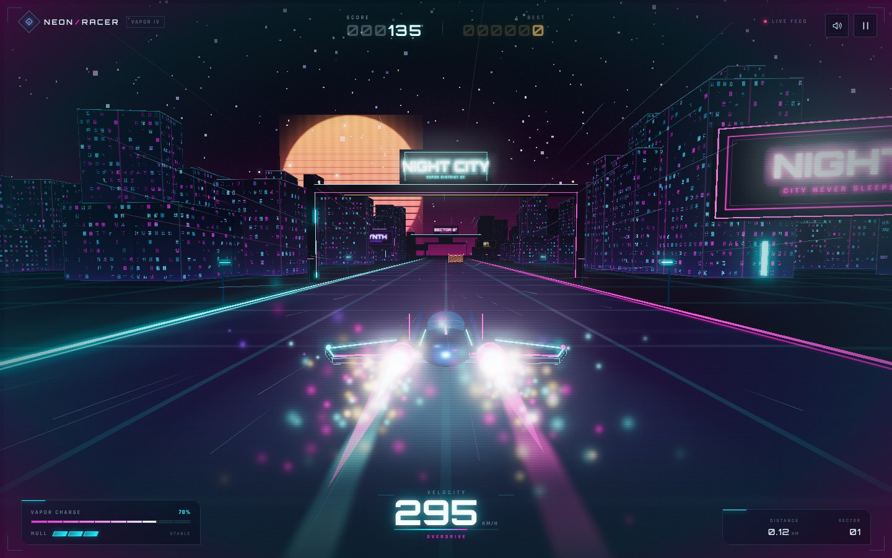

# NEON RACER — Vapor Velocity





A full-viewport, endless neon racer built with **Three.js / WebGL**. Thread a synthwave
city at 400 km/h, dodge holographic barriers, collect vapor cells, and leave a twin
particle wake behind the craft.

No build step. Everything is procedural: the city, road shaders, vehicle, billboards,
particles, and engine audio are generated at runtime.

## Run it

**Double-click `index.html`.** It is an offline-ready build: Three.js is bundled into
`neon-racer.bundle.js` and both display fonts are local. No build step, server, npm
install, or network connection is required.

If your browser or preview environment refuses to run local files, serve the folder
instead:

```bash
cd 02-threejs-webgl/05-neon-racer/deepseek-v4.1-flash
python3 -m http.server 8000
# then open http://localhost:8000
```

Or run `npm start` (the game itself still needs no packages).

## Controls

| Input | Action |
| --- | --- |
| `←` `→` / `A` `D` | Steer |
| `↑` / `W` / hold `Space` while racing | Vapor boost |
| `↓` / `S` | Brake |
| `Space` / `Enter` | Start / retry (from the title and results screens) |
| `P` / `Esc` | Pause / resume |
| `M` | Toggle sound |
| Touch pads | Steer, brake, boost on touch-first devices |

## The run

- Three hull plates. Barriers take one plate each and give you a timed shield after impact.
- **Vapor cells** restore boost, add score, and burst into light.
- Passing a barrier closely awards a **near miss** bonus.
- Boost drains the vapor charge; release and let it refill, or collect a cell.
- The grid tightens and the waves come faster the deeper you go. Best score persists in
  `localStorage`.

## Under the hood

- **Vapor wake** — two dynamic ribbon trails plus a pooled 2,150-sprite point field with
  per-particle velocity, size, age and color. The ribbons replay the engine positions
  through a drifting history buffer; the point shader adds soft-disc falloff, additive
  blending and near-camera fade. Boost pushes the wake toward gold/magenta and increases
  emission.
- **Neon rendering** — `EffectComposer` + `UnrealBloomPass` + `OutputPass`, ACES tone
  mapping, HDR neon materials, a custom sky dome and an outrun sun shader.
- **City** — a single `InstancedMesh` of 156 towers with a custom shader that draws
  procedural windows, LED strips and window-frame edges, then recycles each tower down
  the avenue. Neon gates, angled billboards and light posts stream with the city.
- **Road** — hand-written road and ground shaders: anti-aliased grid and lane lines,
  scrolling transverse strips, wet asphalt reflections and distance fog.
- **Vehicle** — low-poly extruded wings, layered hull, engine pods, animated exhaust
  cones, cockpit glass, rim neon, shield bubble, ground aura and a contact shadow.
- **Audio** — synthesized Web Audio: speed-tracked saw engine, filtered wind, countdown
  beeps, pickup chirps and a filtered-noise impact. Audio starts on the first gesture.
- **Performance** — instancing, pooled scene objects, recycled particles, capped pixel
  ratio and a single bloom pass. The game pauses automatically when the tab/window loses
  focus.

### Source and build

- `main.js` — readable ES-module source.
- `neon-racer.bundle.js` — the prebuilt, minified classic-script bundle that `index.html`
  actually loads. It bundles Three.js and the post-processing add-ons so the game can run
  directly from disk.
- To rebuild after editing `main.js`:

  ```bash
  npm install
  npm run build
  ```

Add `?debug` to the URL to expose `window.__NEON_RACER__` for smoke-testing state and
transitions. Third-party licenses are listed in [`THIRD_PARTY_NOTICES.md`](THIRD_PARTY_NOTICES.md).
